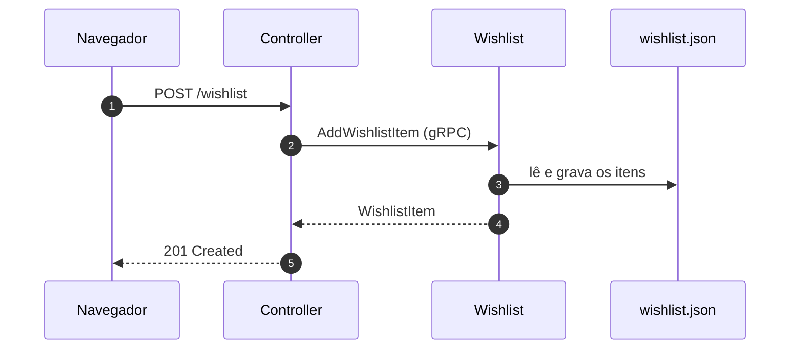

# Microsserviço Wishlist

Documentação técnica e funcional da lista de desejos da Micro-Livraria.

- **Serviço:** `wishlist`
- **Stack:** Node.js, `@grpc/grpc-js` e `@grpc/proto-loader`
- **Porta interna:** `3003`
- **Persistência:** arquivo JSON
- **API pública:** REST, exposta pelo Controller na porta `3000`
- **Especificação OpenAPI:** [openapi.yaml](openapi.yaml)

> Este é um serviço didático. Ele não possui autenticação, banco de dados ou mecanismos de concorrência para uso em produção.

## Sumário

- [Visão geral](#visão-geral)
- [Arquitetura](#arquitetura)
- [Modelo de dados](#modelo-de-dados)
- [API REST](#api-rest)
- [Contrato gRPC](#contrato-grpc)
- [Integração com o frontend](#integração-com-o-frontend)
- [Configuração](#configuração)
- [Persistência](#persistência)
- [Execução](#execução)
- [Testes](#testes)
- [Solução de problemas](#solução-de-problemas)
- [Segurança e limitações](#segurança-e-limitações)
- [Arquivos relacionados](#arquivos-relacionados)
- [Melhorias futuras](#melhorias-futuras)

## Visão geral

O `Wishlist` permite adicionar, listar e remover livros da lista de desejos.

O navegador nunca acessa o serviço gRPC diretamente. O fluxo passa pelo Controller, que também é usado pelas demais funcionalidades da loja:

```text
Frontend → Controller → Wishlist → JSON
```

### Responsabilidades

- Armazenar os itens da lista de desejos.
- Gerar o identificador de cada item.
- Persistir os dados entre reinícios.
- Expor operações de criação, listagem e remoção via gRPC.
- Servir de backend para as rotas REST do Controller.

### Fora do escopo

- Autenticação e autorização.
- Separação real de listas por usuário.
- Validação do livro no Inventory.
- Controle de concorrência e transações.
- Notificações ou integração com sistemas externos.

## Arquitetura

### Componentes

| Componente | Responsabilidade | Porta |
|---|---|---|
| Frontend | Interface web e botões de adicionar/remover | `5000` |
| Controller | API REST e cliente gRPC | `3000` |
| Wishlist | Regras da lista e persistência | `3003` interna |
| JSON | Armazenamento dos itens | — |

### Fluxo de criação



### Fluxo de remoção

1. O frontend chama `DELETE /wishlist/:id`.
2. O Controller valida o ID e chama `RemoveWishlistItem` via gRPC.
3. O Wishlist remove o item e salva o JSON.
4. O Controller responde `204 No Content`.

## Modelo de dados

Cada item é armazenado como um objeto JSON:

```json
{
    "id": 1,
    "bookId": 1,
    "bookName": "Refactoring",
    "userId": "frontend",
    "createdAt": "2026-11-13T01:18:44.672Z"
}
```

| Campo | Tipo | Obrigatório | Descrição |
|---|---|---|---|
| `id` | inteiro | sim | Identificador do item na wishlist. Gerado pelo serviço. |
| `bookId` | inteiro positivo | sim | ID do livro no Inventory. |
| `bookName` | string | não | Nome exibido para o livro. Pode ser vazio. |
| `userId` | string | não | Identificador do usuário. O frontend envia `frontend`. |
| `createdAt` | string ISO 8601 | sim | Data e hora de criação. Gerada pelo serviço. |

O arquivo armazena um array de itens:

```json
[
    {
        "id": 1,
        "bookId": 1,
        "bookName": "Refactoring",
        "userId": "frontend",
        "createdAt": "2026-11-13T01:18:44.672Z"
    }
]
```

### Regras de identificação

- O `id` é calculado como o maior `id` existente + 1.
- Se o item de maior `id` for removido, o próximo item pode reutilizar esse número.
- O `bookId` identifica o livro; o `id` identifica o item da lista.
- A API permite mais de um item com o mesmo `bookId` quando chamada diretamente.

## API REST

### Base URL

```text
http://localhost:3000
```

### Convenções

- Formato: JSON.
- Cabeçalho de envio: `Content-Type: application/json`.
- Autenticação: nenhuma.
- Erros seguem o formato:

```json
{
    "error": "descrição do erro"
}
```

### Resumo das rotas

| Método | Rota | Descrição | Sucesso |
|---|---|---|---|
| `POST` | `/wishlist` | Cria um item | `201 Created` |
| `GET` | `/wishlist` | Lista todos os itens | `200 OK` |
| `DELETE` | `/wishlist/:id` | Remove um item pelo ID | `204 No Content` |

### Criar item

```http
POST /wishlist
Content-Type: application/json
```

Corpo:

| Campo | Tipo | Obrigatório | Descrição |
|---|---|---|---|
| `bookId` | inteiro positivo | sim | ID do livro. |
| `bookName` | string | não | Nome do livro para exibição. |
| `userId` | string | não | Identificador do usuário. |

Exemplo:

```json
{
    "bookId": 1,
    "bookName": "Refactoring",
    "userId": "frontend"
}
```

Resposta `201 Created`:

```json
{
    "id": 1,
    "bookId": 1,
    "bookName": "Refactoring",
    "userId": "frontend",
    "createdAt": "2026-11-13T01:18:44.672Z"
}
```

Erros:

- `400 Bad Request`: `bookId` ausente ou inválido.
- `500 Internal Server Error`: falha na comunicação com o Wishlist ou na persistência.

Exemplo de resposta `400`:

```json
{
    "error": "bookId is required and must be a positive integer"
}
```

### Listar itens

```http
GET /wishlist
```

Resposta `200 OK`:

```json
[
    {
        "id": 1,
        "bookId": 1,
        "bookName": "Refactoring",
        "userId": "frontend",
        "createdAt": "2026-11-13T01:18:44.672Z"
    }
]
```

A resposta é um **array diretamente**, não um objeto com a propriedade `items`.

A rota retorna todos os itens, independentemente do `userId`.

### Remover item

```http
DELETE /wishlist/:id
```

Parâmetro:

| Parâmetro | Tipo | Descrição |
|---|---|---|
| `id` | inteiro positivo | ID do item da wishlist. |

Resposta `204 No Content`: sem corpo.

Erros:

- `400 Bad Request`: `id` ausente ou inválido.
- `404 Not Found`: item inexistente.
- `500 Internal Server Error`: falha na comunicação com o Wishlist ou na persistência.

Exemplo de resposta `404`:

```json
{
    "error": "wishlist item not found"
}
```

### Códigos de status

| Código | Significado |
|---|---|
| `200` | Listagem realizada com sucesso. |
| `201` | Item criado com sucesso. |
| `204` | Item removido com sucesso. |
| `400` | Dados de entrada inválidos. |
| `404` | Item não encontrado. |
| `500` | Falha interna ou de comunicação com o Wishlist. |

### Duplicidade e idempotência

- `POST /wishlist` **não é idempotente**: chamadas repetidas podem criar itens duplicados.
- A interface evita duplicidade usando o `bookId` para alternar entre adicionar e remover.
- `DELETE /wishlist/:id` remove o estado do item; uma segunda chamada para o mesmo ID retorna `404`.

## Contrato gRPC

Arquivo: [`proto/wishlist.proto`](../proto/wishlist.proto)

```proto
service WishlistService {
    rpc AddWishlistItem(WishlistItemPayload) returns (WishlistItem) {}
    rpc ListWishlistItems(WishlistEmpty) returns (WishlistResponse) {}
    rpc RemoveWishlistItem(WishlistItemIdPayload) returns (WishlistEmpty) {}
}
```

| Método | Entrada | Saída |
|---|---|---|
| `AddWishlistItem` | `WishlistItemPayload` | `WishlistItem` |
| `ListWishlistItems` | `WishlistEmpty` | `WishlistResponse` |
| `RemoveWishlistItem` | `WishlistItemIdPayload` | `WishlistEmpty` |

O Controller se conecta ao endereço definido em `WISHLIST_ADDR`:

- Local: `127.0.0.1:3003`
- Docker Compose: `wishlist:3003`

## Integração com o frontend

O frontend não exibe uma seção separada da wishlist. O estado é controlado pelos botões de cada livro:

- Fora da lista: **Adicionar à lista**.
- Na lista: **Remover da lista**.

Comportamento:

1. Ao carregar a página, o frontend busca produtos e wishlist em paralelo.
2. O frontend usa `userId: "frontend"` ao criar um item.
3. O botão é atualizado com base no `bookId` presente na lista.
4. Ao adicionar, envia `POST /wishlist`.
5. Ao remover, envia `DELETE /wishlist/:id`.
6. O feedback é exibido com `swal`.

A lista é **compartilhada** entre os navegadores.

## Configuração

### Wishlist

| Variável | Padrão local | Padrão Docker | Descrição |
|---|---|---|---|
| `WISHLIST_HOST` | `127.0.0.1` | `0.0.0.0` | Host de bind do gRPC. |
| `WISHLIST_PORT` | `3003` | `3003` | Porta do gRPC. |
| `WISHLIST_DATA_FILE` | `services/wishlist/data/wishlist.json` | `/app/data/wishlist.json` | Arquivo de persistência. |

### Controller

| Variável | Padrão local | Padrão Compose | Descrição |
|---|---|---|---|
| `PORT` | `3000` | `3000` | Porta REST do Controller. |
| `WISHLIST_ADDR` | `127.0.0.1:3003` | `wishlist:3003` | Endereço gRPC do Wishlist. |

## Persistência

### Local

```text
services/wishlist/data/wishlist.json
```

O diretório é criado automaticamente. O arquivo é ignorado pelo Git.

### Docker

```text
/app/data/wishlist.json
```

O diretório `/app/data` é montado no volume nomeado `wishlist_data`.

### Resetar os dados

```bash
docker compose down -v
docker compose up --build
```

> O comando `down -v` remove o volume e, portanto, todos os itens da wishlist.

### Observações

- A leitura e a escrita usam `fs` síncrono.
- Não há controle de concorrência entre processos ou requisições simultâneas.
- O JSON é adequado ao exemplo didático, mas não substitui um banco de dados em produção.

## Execução

### Docker Compose

Na raiz do projeto:

```bash
docker compose up --build
```

Endereços:

- Frontend: `http://localhost:5000`
- API: `http://localhost:3000`

Comandos úteis:

```bash
docker compose ps
docker compose logs -f wishlist controller
docker compose restart wishlist
docker compose down
```

### Execução local

Pare o Docker Compose antes para evitar conflito de portas.

```bash
npm install
npm run start
```

O script `start` inclui o serviço `wishlist`.

## Testes

### REST Client do VS Code

Use o arquivo [`requests.http`](../requests.http). Ele contém:

- listagem de produtos;
- cálculo de frete;
- criação de itens;
- listagem da wishlist;
- remoção de item;
- remoção de item inexistente;
- requisição inválida.

### curl no Bash

Criar:

```bash
curl -X POST http://localhost:3000/wishlist \
  -H "Content-Type: application/json" \
  -d '{"bookId":1,"bookName":"Refactoring","userId":"frontend"}'
```

Listar:

```bash
curl http://localhost:3000/wishlist
```

Remover o item de ID 1:

```bash
curl -X DELETE http://localhost:3000/wishlist/1
```

### curl.exe no PowerShell

No PowerShell 5.1, o envio direto de JSON com `-d '...'` pode perder as aspas ao chamar um executável nativo. Envie o JSON pela entrada padrão:

```powershell
'{"bookId":1,"bookName":"Refactoring","userId":"frontend"}' |
    curl.exe -X POST http://localhost:3000/wishlist `
        -H "Content-Type: application/json" `
        -d "@-"
```

Listar:

```powershell
curl.exe http://localhost:3000/wishlist
```

Remover:

```powershell
curl.exe -X DELETE http://localhost:3000/wishlist/1
```

### Invoke-RestMethod no PowerShell

Criar:

```powershell
$body = @{
    bookId   = 1
    bookName = "Refactoring"
    userId   = "frontend"
} | ConvertTo-Json

Invoke-RestMethod -Uri "http://localhost:3000/wishlist" `
    -Method Post `
    -ContentType "application/json" `
    -Body $body | ConvertTo-Json -Depth 5
```

Listar:

```powershell
Invoke-RestMethod -Uri "http://localhost:3000/wishlist" -Method Get | ConvertTo-Json -Depth 5
```

Remover:

```powershell
Invoke-WebRequest -Uri "http://localhost:3000/wishlist/1" -Method Delete -UseBasicParsing
```

### Resultados esperados

| Operação | Resultado esperado |
|---|---|
| Criar com `bookId` válido | `201` e item com `id` e `createdAt` |
| Criar sem `bookId` | `400` |
| Listar | `200` e array de itens |
| Remover item existente | `204` |
| Remover item inexistente | `404` |
| Remover ID inválido | `400` |

### Teste manual do frontend

1. Abra `http://localhost:5000`.
2. Clique em **Adicionar à lista** em um livro.
3. Verifique o feedback e o botão **Remover da lista**.
4. Clique novamente para remover.
5. Recarregue a página e confirme que o estado foi mantido.

## Solução de problemas

### O botão mostra “Remover da lista”

O livro já está na wishlist compartilhada. Clique para remover ou consulte:

```powershell
Invoke-RestMethod -Uri "http://localhost:3000/wishlist" -Method Get | ConvertTo-Json -Depth 5
```

### Erro 500

Verifique os logs:

```bash
docker compose logs -f controller wishlist
```

Confirme também se o Controller consegue resolver o host `wishlist` na rede Docker.

### Erro 404 ao remover

O item pode já ter sido removido por outra aba ou por outra chamada. Liste os itens novamente para obter o `id` atualizado.

### Portas ocupadas

As portas `3000` e `5000` precisam estar livres no host. Encerre processos antigos ou ajuste o mapeamento no `docker-compose.yml`.

### Dados não persistem

- Em Docker, verifique se o volume `wishlist_data` está montado em `/app/data`.
- Em execução local, verifique `services/wishlist/data/wishlist.json`.
- O comando `docker compose down -v` apaga os dados intencionalmente.

### JSON inválido com curl no PowerShell

Use a forma com pipe e `-d "@-"` mostrada na seção de testes.

## Segurança e limitações

- Não há autenticação nem autorização.
- A lista é compartilhada entre todos os navegadores.
- O `userId` é apenas informativo; não há isolamento por usuário.
- O CORS está aberto para todas as origens.
- Não há HTTPS.
- O `bookId` não é validado contra o Inventory.
- A API permite duplicidade quando chamada diretamente.
- A persistência em JSON não possui transações, locks ou recuperação de falhas.
- Não há testes automatizados no repositório.
- O serviço não deve ser exposto publicamente sem autenticação, validação e um banco de dados adequado.

## Arquivos relacionados

| Arquivo | Função |
|---|---|
| `proto/wishlist.proto` | Contrato gRPC. |
| `services/wishlist/index.js` | Implementação do serviço e persistência. |
| `services/controller/wishlist.js` | Cliente gRPC do Controller. |
| `services/controller/index.js` | Rotas REST do wishlist. |
| `services/frontend/index.js` | Integração dos botões no frontend. |
| `wishlist.Dockerfile` | Imagem Docker do serviço. |
| `docker-compose.yml` | Stack completa, rede e volume. |
| `requests.http` | Exemplos de requisições. |
| `docs/openapi.yaml` | Especificação OpenAPI da API REST. |

## Melhorias futuras

- Autenticação e listas por usuário.
- Banco de dados relacional ou documental.
- Validação do `bookId` no Inventory.
- Remoção em lote.
- Healthchecks no Docker Compose.
- Logs estruturados.
- Testes automatizados de API e frontend.
- Geração de clientes e documentação a partir do OpenAPI.
- Limitação de taxa e CORS restrito.
